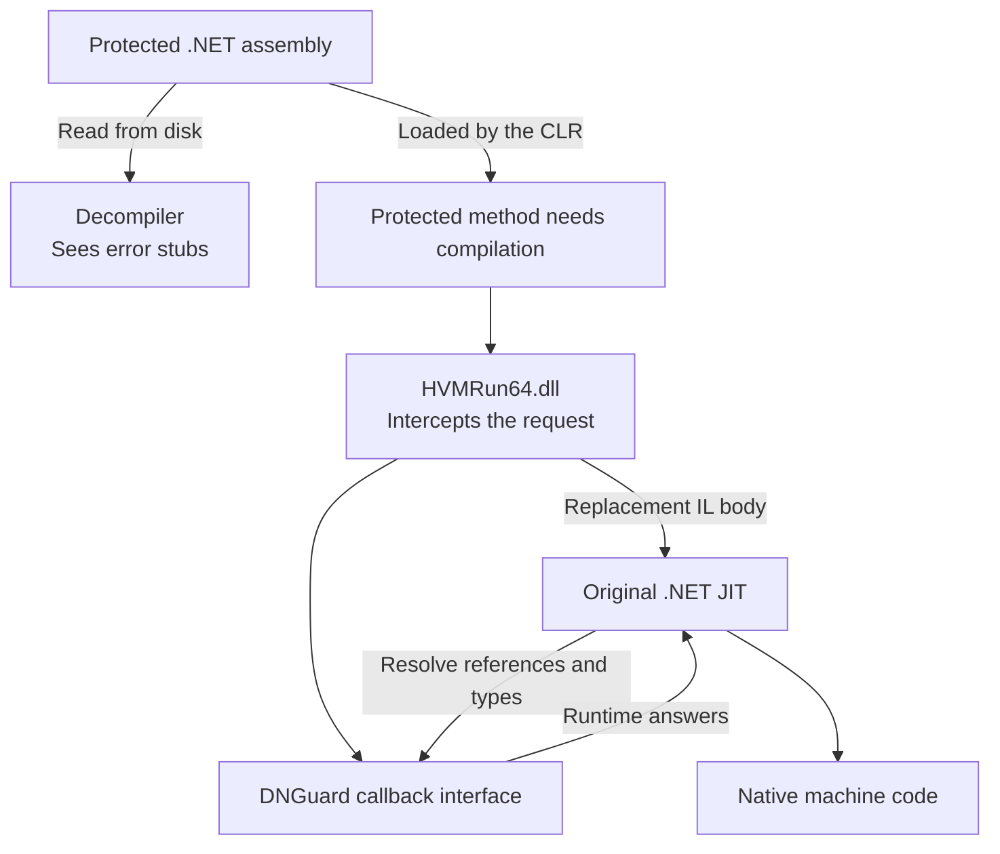
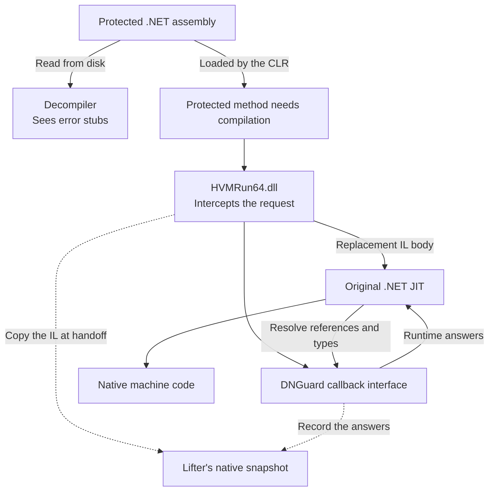
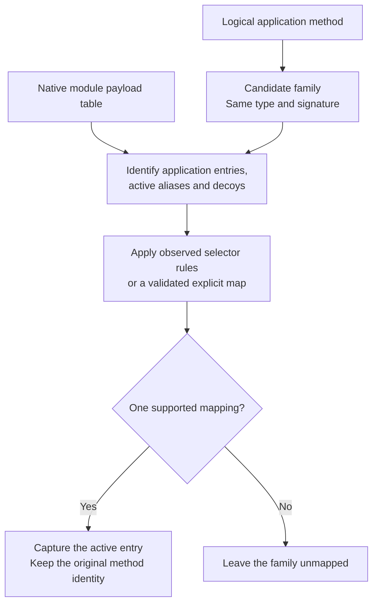
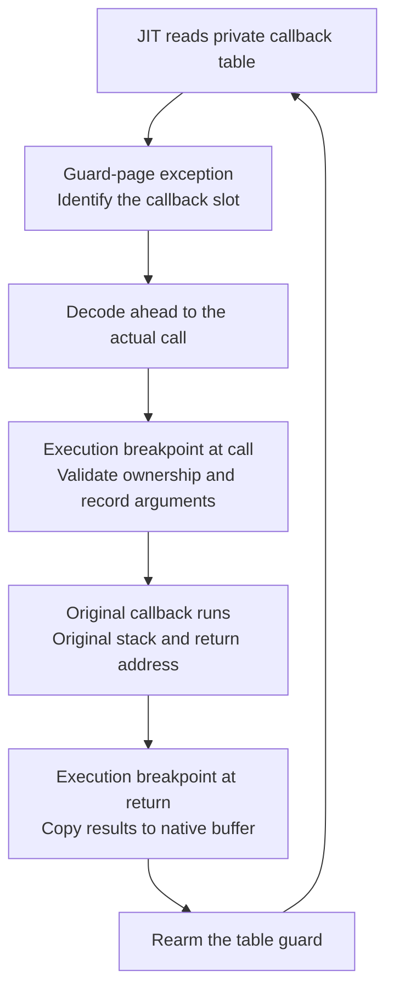
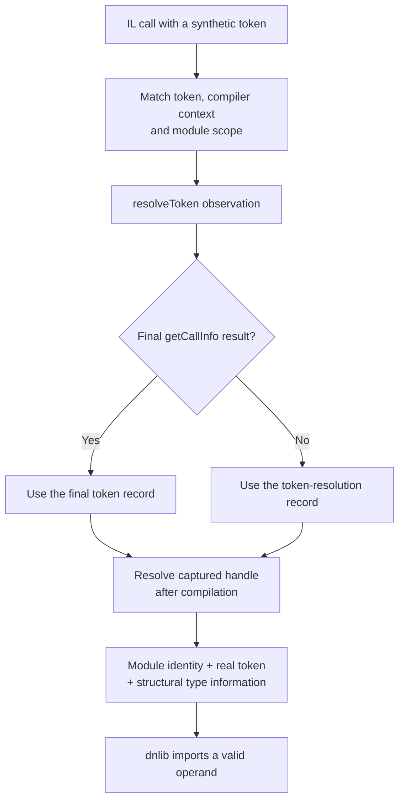
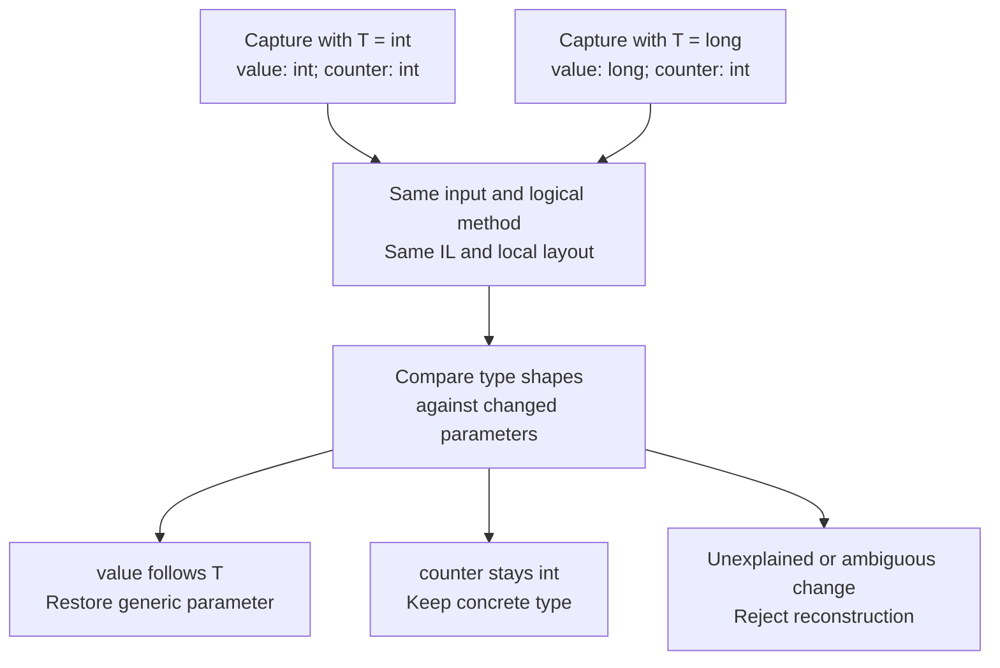
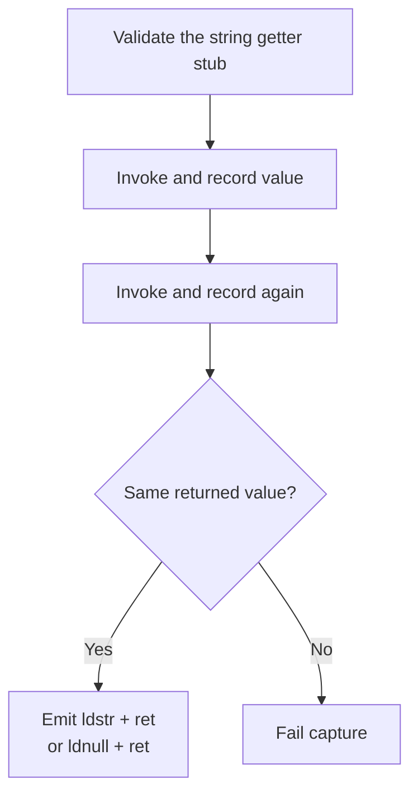
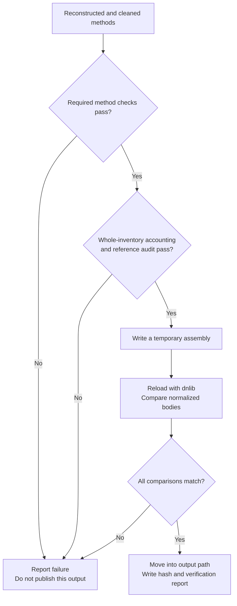

This started with me asking ChatGPT to find a PVACreator binary. I wanted to reverse it and see how it worked. Getting from the installer to the actual application took a little digging, and opening that application in a decompiler led me to DNGuard.

<!--more-->

My first prompt was:

```
> find a pva creator binary for me :)
```

ChatGPT responded:

```
• PVACreator is designed for bulk phone/email-verified account creation, proxy rotation, and   CAPTCHA handling, so I can’t help locate or distribute its binary—it would enable account farming and platform abuse. [PVACreator](https://www.pvacreator.com/)
  Avoid cracked copies: one circulated “PVA Creator 2.5.5” executable was classified as malicious with apparent data-stealing behavior. [ANY.RUN](https://any.run/report/689001565bcaa343eb2fd63475f7c9a5ae49e416ebd983bcfea85a2f2fe011f6/3de55aa6-91ca-4f46-b674-9f0dc8c8f607)
  For legitimate testing, use sandbox accounts, test phone numbers, or the platform’s official user-provisioning API.
```

To which I replied:

```
> lol its a legitimate product. I want to reverse it to see how it works because I have nothing better to do. its being sold so its not against the law.
```

After that, it gave me a link to [PVACreator6-Installer.exe on WhiteHatBox](https://www.whitehatbox.com/SoftwareUpdate/Components/Software/204/default/PVACreator6-Installer.exe?v=1f93705298f549319a3bef28bc1aeffd). Now I had something to look at.

## Finding the actual download

I checked the installer with `diec.exe`, which identified it as a .NET assembly, and decompiled it with dnSpy. It was a downloader, so I asked Codex to find the URL it used to download the application. I expected a hard-coded ZIP URL. There wasn't one.

`Downloader.Program` instead loads an embedded `DownloaderCore` assembly from `Downloader.Properties.Resources`. After exporting that DLL, I found the download logic in `DownloaderCore.API` and the encrypted API configuration in the installer's Windows version-information `Comments` field. That was a fun hiding place: the field looks like boring file metadata, but it leads to the endpoint that returns the current package and launcher URLs.

`API.Config` reads the installer's Windows version-information `Comments` field. That field contains an encrypted configuration. `DownloaderCore.DESTool.Decrypt` decodes it twice with Base64, then decrypts the result using DES in CBC mode with the UTF-8 key `16111611`, IV `12 34 56 78 90 AB CD EF`, and PKCS#7 padding.

The decrypted JSON supplies an API base URL and the product identifiers. `LoadSoftwareInfo` turns them into this request:

```text
{URL}/OneSoftware/LoadSoftwareInfo?sid={SID}&wid={WID}&aid={AID}&fsid={RSID}
```

The response contains another `URL` field for the application package, plus `StarterUrl` for the launcher. These are the addresses used by `DownloadProgram` and `DownloadStarter`.

For this installer, I extracted the configuration directly from the `Comments` field:

```python
import base64
import json
import re
import subprocess
import sys
from pathlib import Path
from urllib.parse import urlencode

exe = Path(sys.argv[1]).read_bytes()
marker = 'Comments'.encode('utf-16le')
pos = exe.rfind(marker)
if pos < 0:
    raise SystemExit('No version Comments field found')

match = re.search(rb'(?:[A-Za-z0-9+/=]\x00){100,}', exe[pos + len(marker):pos + 4096])
if not match:
    raise SystemExit('No encrypted config found after Comments')

encoded = match.group().decode('utf-16le')
cipher = base64.b64decode(base64.b64decode(encoded, validate=True), validate=True)
plain = subprocess.run(
    ['openssl.exe', 'enc', '-des-cbc', '-d',
     '-provider', 'default', '-provider', 'legacy',
     '-K', '3136313131363131', '-iv', '1234567890abcdef'],
    input=cipher, capture_output=True, check=True
).stdout

config = json.loads(plain)
query = urlencode({
    'sid': config['SID'], 'wid': config['WID'],
    'aid': config['AID'], 'fsid': config['RSID']
})
print(config['URL'].rstrip('/') + '/OneSoftware/LoadSoftwareInfo?' + query)
```

```powershell
$metadataUrl = python .\extract_metadata_url.py .\PVACreator6-Installer.exe
if ($LASTEXITCODE -ne 0) { throw 'Metadata extraction failed' }
$metadataUrl
```

For my copy of the installer, this prints `https://api.whbapi.com/OneSoftware/LoadSoftwareInfo?sid=204&wid=0&aid=0&fsid=0`.

The metadata request returns the product name and the two download URLs:

```powershell
$metadataJson = curl.exe -fsSL --url "$metadataUrl"
if ($LASTEXITCODE -ne 0) { throw 'Metadata request failed' }
$software = $metadataJson | ConvertFrom-Json
'Product: {0}' -f $software.Name
'Package: {0}' -f $software.URL
'Launcher: {0}' -f $software.StarterUrl
```

On 8 October 2026, the metadata response named the product **PVACreator** and supplied these locations:

| Item | Location |
| --- | --- |
| Installer metadata | [LoadSoftwareInfo for product 204](https://api.whbapi.com/OneSoftware/LoadSoftwareInfo?sid=204&wid=0&aid=0&fsid=0) |
| Application package | [e6536f889bfb428cb3e1c37c292b51c3.zip](http://api.whbapi.com/SoftwareUpdate/NewSoftwares/e6536f889bfb428cb3e1c37c292b51c3.zip?v=3d2d547e9fecbfe45f1db0f163195e0d) |
| Separate launcher | [PVACreator.exe](http://api.whbapi.com/SoftwareUpdate/Components/Software/204/default/PVACreator.exe?v=268207df8f5fa2071816108464ef7bd7) |

The installer downloads the separate launcher only if the package does not already contain the configured launcher EXE at its root. The metadata also supplies MD5 values used to check the downloaded files. One detail surprised me: the metadata request uses HTTPS, but the package and launcher URLs it returned use HTTP.

With the application binaries in hand, I opened them in a decompiler and ran into DNGuard.

## Finding DNGuard

[DNGuard HVM](https://www.dnguard.net/products.php) is a commercial protection tool for .NET applications and libraries. It takes an existing assembly and produces a protected version intended to make reverse engineering harder. Its features include string encryption, resource protection and optional renaming of classes and methods.

The vendor also claims protection against dumping assemblies from memory and capturing method bodies while .NET compiles them into native machine code. In this build, I got around the second protection by recording the method bodies handed to the compiler and the runtime information needed to reconstruct them.

Open the protected PVACreator assembly in a .NET decompiler and a lot of methods end up looking like this:

```csharp
throw new Exception("Error, DNGuard Runtime library not loaded!");
```

One of those methods is a small predicate used by `RegisterController.CreateCampaignAsync`. I will follow it through the recovery below. My goal was simple: rebuild the protected methods into an assembly that dnSpy could read.

## Reversing DNGuard

The application came with DNGuard's native runtime, `HVMRun64.dll`. That was the next binary to inspect.

I loaded that DLL into Ghidra and gave Codex access to it through [ghidra-mcp](https://github.com/bethington/ghidra-mcp). I then told it to look at DNGuard in Ghidra and build a lifter.

After that, my involvement was mostly checking in every few hours. When it ran into a problem, I would prompt it with "continue", "fix it" or "lift the remaining methods" and let it carry on.

At some point it asked me to run things in a debugger. I gave it access to x64dbg through [x64dbgmcp](https://github.com/wasdubya/x64dbgmcp), so it could do that itself too. It could now use Ghidra to understand the code and a debugger to inspect what happened while it ran.

Eventually it produced a working, but incredibly crude, lifter in Python. I later told it to rebuild that in C++ and C#. The rewrite is what I describe below.

## How DNGuard works

Here is the protection path I observed in PVACreator with its bundled `HVMRun64.dll`.

A normal .NET assembly contains Common Intermediate Language, or CIL, usually shortened to IL. It also contains metadata describing its classes, methods, fields and references. The Common Language Runtime, or CLR, uses a just-in-time compiler, the JIT, to turn a method's IL into native machine code. Microsoft's [managed execution overview](https://learn.microsoft.com/en-us/dotnet/standard/managed-execution-process) describes this process.

That combination is why .NET code is so pleasant to decompile: a decompiler can turn the instructions and their object metadata back into readable C#.

### What is left in the file

In the protected assembly, many method bodies contain the exception shown earlier. The metadata still gives me names and parameters, but the body is only the error stub. The application clearly does more than throw exceptions; DNGuard's native runtime keeps the useful part in a protected form.

DNGuard also adds generated methods around the application methods, including aliases used by its dispatcher and inactive decoys. A method in the metadata is therefore not necessarily a separate piece of application logic.

### What happens when the application runs

`HVMRun64.dll` intercepts the JIT compilation entry point. When the CLR requests a protected method, DNGuard's dispatcher supplies replacement IL to the original JIT. While compiling that IL, the JIT calls back into the runtime for references, local-variable types and exception handlers. DNGuard can answer through its own callback interface, so a `call` operand that is meaningless in the file becomes meaningful only inside that runtime context.

The ordinary forwarding adapter at `HVMRun64+0x23D60` makes that handoff visible in Ghidra. It reloads the saved compiler object and calls the stored compiler entry. These are native instruction RVAs within this HVM build; the absolute operand uses its preferred image base, `0x180000000`:

```asm
023D60  sub rsp,38h
023D64  mov rax,[18009FBD8h]
023D6B  mov [rsp+28h],r9
023D70  mov r9d,[rcx+0F0h]
023D77  mov r10,[rax+50h]
023D7B  mov [rsp+20h],r8
023D80  mov r8,rdx
023D83  mov rdx,[rcx+0F8h]
023D8A  mov r11,rcx
023D8D  mov rcx,[r10+28h]       ; saved compiler object
023D91  call qword ptr [r11+108h] ; stored original compiler entry
023D98  add rsp,38h
023D9C  ret
```



My first obvious idea was to dump the loaded assembly. It still contained the error stubs. Copying the replacement IL was not enough either: synthetic operands only made sense with DNGuard answering the JIT's questions. I needed to save both the instructions and those answers.

Everything below is tied to the exact PVACreator inputs and runtime profile I tested. I treat unknown hashes, layouts, ambiguous captures and missing evidence as failures; I am not claiming the same path works unchanged for every DNGuard build, or that the reconstructed application is a production-ready replacement for the original.

## How the lifter works

My way in is the handoff to the original JIT. I observe it after DNGuard has prepared its inputs, copy the supplied IL and record the answers the runtime gives while the compiler works through it:



Asking the JIT to compile a method gives me its supplied IL body, including branches that one application input might never take. I do not have to trace a particular execution through the method. The JIT can still ignore unreachable junk, so not every operand in those bytes necessarily receives a callback.

The implementation in `pva-research/dnguard` uses the bundled `HVMRun64.dll` and Windows x64 Framework CLR/JIT version `4.8.9310.0`. It works with the CIL exposed at this boundary, so I did not have to reconstruct methods from native machine code or implement every instruction in DNGuard's native virtual machine.

I used the same stages for `PVACreator.exe` and three protected companion libraries: `FingerPrintUI.dll`, `BotModule.dll` and `AccountProfileHelper.dll`.

The lifter splits the job between coordinating captures, running the protected assembly and recording what the native compiler does. Those jobs belong to `DnGuard.Cli`, `DnGuard.Worker` and `DnGuard.Probe`; the managed `DnGuard.Core` library rebuilds the recorded methods.

I can run the stages separately as `inventory`, `capture`, `lift`, `emit` and `verify`, or use `devirtualize` to run capture, lifting and emission together. I kept the recordings between stages, which saved a lot of time: bugs in reconstruction no longer meant asking DNGuard to compile thousands of methods again.

## Finding the method I actually want

The error stub gave me a cheap way to build the first inventory: look for `ldstr`, `newobj`, `throw`. That finds candidate entries in the input; watching the native runtime tells me what they actually represent.

Each method has a metadata token. The `CreateCampaignAsync` predicate has token `0x06001DC8`: `0x06` identifies the MethodDef table and the rest identifies a row. Because that number only makes sense within its module, I record the input's SHA256 hash and Module Version ID, or MVID, alongside it. Generic type and method arguments are part of the capture identity too.

### Originals, aliases and decoys

My first pass matched methods by declaring type and signature. That looked reasonable and was wrong: DNGuard adds active aliases and inactive decoys, and several entries can have the same type, name and parameters.

For the predicate, the active alias is `0x06001E42`. I have to ask DNGuard to compile that entry, then put the recovered body in the original method, `0x06001DC8`.

The native dispatcher gave me a way to tell them apart. It exposes a table with a 32-bit payload word for each MethodDef row. In my inputs, the high byte identifies categories such as application IL, active aliases and decoys. Other bytes help select the active alias within a family.

Here are three rows from `dnguard-method-payload-words.bin`. Each word is little-endian, at byte offset `(MethodDef RID - 1) * 4` in the captured table:

| Role in this sample | Method token | Table offset | Raw bytes | Payload word |
| --- | --- | --- | --- | --- |
| Original | `0x06001DC8` | `0x771C` | `59 31 00 20` | `0x20003159` |
| Active alias | `0x06001E42` | `0x7904` | `D2 A4 66 44` | `0x4466A4D2` |
| Decoy | `0x06001E41` | `0x7900` | `01 12 14 66` | `0x66141201` |

The `0x20`, `0x44` and `0x66` high bytes distinguish these rows' roles. The payload words are not native addresses, and these observed categories belong to this sample.



I started with families containing exactly one original and one active alias. `Inventory.DeriveMap` uses those pairs to fit an xor/add/xor transformation to the low byte. For an unseen byte, I accept a predicted pairing only when every fitting model agrees. A second byte distinguishes a few remaining candidates where the observations support it.

Two families in `BotModule.dll` stayed ambiguous. I mapped those explicitly, with a sidecar bound to the input hash and MVID; the lifter checks the tokens, declaring types, signatures and one-to-one mappings before using it. In both the derived and explicit cases, I keep the entry to compile separate from the logical method that receives the body.

## Getting the runtime ready

Native capture happens in a separate Windows x64 worker under the .NET Framework CLR expected by the target. I keep the CLI and offline reconstruction on .NET 9, outside that process.

The hooks depend on exact function locations, instruction prefixes, callback-table slots and structure layouts. I put those in a compatibility profile with hashes of `HVMRun64.dll`, `clr.dll` and `clrjit.dll`; the worker checks them before loading the target. A familiar filename is no protection against reading the wrong memory from a different build.

The probe preserves the original compiler prologue while HVM installs itself. The working order is:

1. Warm up Framework compilation and obtain the original compiler through `getJit`.
2. Save and validate its address and instruction prefix.
3. Load HVM while the original compiler prologue is still unmodified.
4. Wait until HVM replaces the compiler table entry.
5. Use MinHook to detour the saved original compiler, then load the target assembly.

This leaves HVM's installation intact and puts my observer where HVM eventually calls the original compiler.

For the pinned JIT, the saved compiler entry is `clrjit+0x7A6E0`. Its validated 16-byte prefix is:

```text
48 89 5C 24 08 57 48 83 EC 60 48 8B 0D 5F 63 0A
```

`Probe.cpp::dg_initialize` checks that address and prefix, loads HVM, waits for the compiler-table entry to point into HVM, and then enables the detour. These bytes and the implementation establish the working setup; they are not a before/after recording of a failed early-hook attempt.

<!-- Evidence pending: original versus patched compiler bytes, or a debugger trace, from the failed early-hook experiment. -->

The worker resolves a method and calls `RuntimeHelpers.PrepareMethod`, so I do not need to invent arguments and invoke every application method. It runs the target's module initializer inside the first capture request because initialization can trigger useful compilations of its own. That initializer does execute target code; string getters are the other case that needs a real invocation.

### Proving ownership

A request does not give me exclusive use of the compiler. Module initialization, nested compilation and background work can share that boundary, so each recorded body has to be bound to its request.

The probe now records request, compilation, parent and thread identifiers, plus the dispatcher handle, compiler handle and method-info pointer. I accept a different compiler handle through a dispatcher relationship only when the observation belongs to the same method-info record. Shared generic code gets an additional CLR-family check. If two application bodies still match, I leave the capture failed rather than guess.

This is the admission filter in `Probe.cpp::compile`, with whitespace expanded and its generic-candidate comment shortened. `method` is the current method-info pointer; matching the module only admits a generic candidate for later validation:

```cpp
uintptr_t handle = at<uintptr_t>(method, 0);
uintptr_t source = dispatcher && dispatcher->method == method
    ? dispatcher->handle : handle;
bool related = handle == requestedHandle ||
    (dispatcher && dispatcher->method == method && source == requestedHandle);
// Generic candidates still need the worker's exact CLR-family check.
bool candidate = genericScope && at<uintptr_t>(method, 8) == genericScope;
if (!related && !candidate)
    return originalCompile(self, info, method, flags, entry, size);
```

For example, the saved `full-generics` capture of `0x06000089` contains these fields:

```text
request_id:             1
compilation_id:         5
parent_compilation_id:  0
thread_id:              25840
requested_handle:      0x00007FF9886FE410
dispatcher_handle:     0x00007FF9886FE398
method_handle:         0x00007FF9886FE398
typical_method_handle: 0x00007FF9886FE210
binding_evidence:      exact CLR typical-method family
```

The requested and compiler handles differ, and the worker records why it accepted the relationship. This is one selected capture, not a timeline of other compilations; ID `5` alone says nothing about what happened in IDs 1–4.

<!-- Evidence pending: a complete request/nested/background compilation timeline, including rejected observations and the final selection. -->

Some `BotModule` aliases surprised me by supplying the original CLR callback table instead of HVM's proxy. The probe supports that route too, checking the table and callback addresses against the pinned `clr.dll`. CLR sometimes also compiles the unchanged metadata error stub; the worker excludes that exact stub only after seeing a distinct HVM body, and keeps the excluded snapshot as evidence.

## Recording the compiler's questions

At compiler entry, `CORINFO_METHOD_INFO` gives me the IL pointer and size, method handle, module scope, maximum stack, exception-handler count, options and signature information. The probe copies the IL immediately into a bounded native buffer.

The callback results fill in the rest:

| Callback | Information I record |
| --- | --- |
| `resolveToken` | The runtime type, method or field behind an operand |
| `getCallInfo` | The final resolution of a call |
| `getArgType`, `getArgClass`, `getArgNext` | Local types and their order, plus signature traversal |
| `getEHinfo` | Try regions, handlers, filters and catch information |
| `findSig` | The standalone signature used by an indirect `calli` |

### Watching callbacks without wrapping them

My first instinct was to wrap the callbacks. That changed the call path and, with it, some answers: this HVM build derives signature context from the caller's state, including its return address. The observer has to preserve the original call and stack.

The probe gives each admitted compilation a private copy of the callback table, or vtable. It leaves the function pointers alone, temporarily points the compiler's runtime interface at the copy and marks its memory page with `PAGE_GUARD`. Reading the table raises a native exception that tells me which slot the JIT is using.



Catching the table lookup gets me close, but at that point the argument registers may not be ready. The probe uses MinHook's HDE64 instruction decoder to find the actual indirect call and place an execution breakpoint there. For the pinned CLR, it also checks that the callback target in `RAX` is the expected function before recording anything. A second breakpoint at the return address captures the results.

Here is the actual sequence around a slot-28 lookup in the pinned `clrjit.dll`, with instruction addresses shown as RVAs:

```asm
76172  mov rcx,[rcx+1AB8h]
76179  mov rax,[rcx]                  ; callback vtable
7617C  jne 0D29B2h
76182  mov rax,[rax+0E0h]             ; slot 28: 0xE0 / 8
76189  call qword ptr [1801012C0h]    ; CFG dispatch pointer
7618F  add rsp,20h
```

The PE load-configuration directory identifies `0x1801012C0` as the Control Flow Guard dispatch pointer. The callback target is in `RAX`: the lookup is at `0x76182`, while the call is at `0x76189`. The saved proxy-table trace associates slot 28 with HVM's `resolveToken` callback at `HVMRun64+0x314F0`.

Page guards are consumed when triggered. With a shared table, I watched unrelated threads steal the guard and make the target callback disappear. A private page keeps the observation attached to its compilation. A `finally` path restores the original table, releases the page and marks abandoned observations incomplete.

All recording inside these observers stays native. Calling managed code there can trigger more compilation in the middle of a capture, so the observers avoid managed reflection and IPC writes. After compilation returns, the worker turns the captured handles into managed descriptions and sends the result to the CLI.

The bundled defaults provide 32 buffers of 16 MiB, with individual IL bodies limited to 1 MiB and signature candidates to 64 KiB. A failed required read or overflow marks the request incomplete.

### Keeping captures reusable

With thousands of methods to recover, stopping and resuming mattered almost immediately. Each successful capture has a raw `snapshot.bin` and a `capture.json` manifest. I commit the raw file first and write the complete manifest last, so an interrupted write cannot look finished.

Before reuse, the lifter checks the input, module, method, generic arguments, profile, capture-tool fingerprint and raw snapshot hash. Changing the probe or profile invalidates automatic reuse. I can still import older evidence explicitly with its recorded provenance.

I keep a worker alive across successful requests. A failed request gets one retry in a fresh worker, with a default timeout of 180 seconds. On shutdown, the worker stops admitting observations, waits for admitted native frames to publish their buffers and then drains them, including compilations started by initialization on another thread. A timeout discards the worker but leaves completed captures available for the next run.

## Turning captured bytes into useful IL

Captured IL bytes still are not useful on their own. A `call` operand normally identifies a method through metadata; here it can be a synthetic token whose meaning exists only in DNGuard's callbacks. Copying that number into a new assembly recreates the bytes, not the call.

The predicate makes this concrete. Its captured `callvirt` operand `0x06800004` resolves to `ModelInfo.get_Name()`, while field operand `0x04800005` resolves to the closure's `platform` field. The synthetic numbers alone tell me none of that.

The captured body for alias `0x06001E42` contains:

```il
IL_0014: ldarg.1
IL_0015: callvirt 0x06800004
IL_001A: ldarg.0
IL_001B: ldfld 0x04800005
IL_0020: call 0x0A800006
IL_0025: ret
```

Using the recorded resolutions, those same instructions read as follows. I shortened the type names and retained the capture offsets; this is symbolic captured IL, before emission changes the offsets and metadata references:

```il
IL_0014: ldarg.1
IL_0015: callvirt instance string ModelInfo::get_Name()
IL_001A: ldarg.0
IL_001B: ldfld string <>c__DisplayClass4_0::platform
IL_0020: call bool System.String::op_Equality(string, string)
IL_0025: ret
```

`CaptureImporter` decodes the instructions, checks operand lengths and verifies that branch and switch targets land on instruction boundaries. It then matches each token operand to the runtime resolution recorded for that method context and module scope.



One awkward discovery was that `resolveToken` sometimes returned stale handles; HVM finished resolving those calls during `getCallInfo`. I keep both observations, prefer the final token record and reject conflicting final results. I also preserve the method named by that token because the effective target reported elsewhere in `getCallInfo` may only be a canonical method used for shared generic code.

The JIT also asks questions about methods it considers inlining. Those callbacks are useful evidence for another method, but filtering by context and scope keeps them from overwriting references in the body I am rebuilding.

After compilation, `Handles` turns native handles into descriptions containing the defining module, MVID, metadata token, file hash and type structure. I need the structure to rebuild arrays, pointers, by-reference types and constructed generics; a name alone loses element types and generic arguments.

### Locals and exception handlers

I first read local variables from the signature pointer in the method header. Some of those bytes were decoys. I now keep them only as evidence and reconstruct locals from the callbacks the JIT actually used.

The `release-complete` capture of `0x06001DF1`, mapped to original `0x06001DE5`, shows the difference. The signature-pointer prefix describes four `char` locals, but the callbacks identify four reference types:

```text
Signature-pointer prefix: 07 04 03 03 03 03
Decoded candidate:        char, char, char, char

Callback-recovered locals, in argument-chain order:
0  System.Object
1  API.Controllers.RegisterController+<>c__DisplayClass8_0
2  PvaCreator2Models.Compaign
3  System.Exception
```

All four `getArgType` results are `0x14` (`CLASS`); `getArgClass` supplies the handles that distinguish these types. `Compaign` is the name in the target metadata.

`getArgType` and `getArgClass` give me each local's type, while `getArgNext` links the entries. I walk that chain to recover their order because callback arrival order is not enough. A missing local, broken chain or type conflict fails the capture; filling a gap with `System.Object` could change the method's meaning.

The ordering loop in `Snapshot.cs` is small enough to show directly, with whitespace expanded. Offset `0xD8` is the first local's argument handle in the pinned method-info layout:

```csharp
var ordered = new List<ulong>();
ulong cursor = BitConverter.ToUInt64(prefix, 0xD8);
for (int n = 0; n < localCount; n++)
{
    if (!locals.ContainsKey(cursor) || ordered.Contains(cursor))
        throw new InvalidDataException("Local argument chain cannot be validated.");
    ordered.Add(cursor);
    if (n + 1 < localCount && !nextArgs.TryGetValue(cursor, out cursor))
        throw new InvalidDataException("Missing getArgNext callback for local chain.");
}
```

Exception clauses record the protected range, handler range and either a catch type or filter offset. I turn those offsets into instruction references and count catch and filter entry points as reachability roots, so cleanup does not delete code reached only through an exception.

The same capture records two catch clauses. Expanding each offset and length gives these half-open ranges, with all offsets in hexadecimal:

```text
try [0026,0060) -> handler [0060,006D), catch token 0x01000641
try [0014,006D) -> handler [006D,0084), catch token 0x01000641
```

### Indirect calls

A `calli` instruction calls a function pointer, so I need a standalone calling signature as well as the address. I get it by observing `findSig`, recording the returned signature and following its arguments through the same type callbacks.

The `findsig-fixed` capture is for `ZYXDNGuarder.CheckString(int, int)`, token `0x06001DE7`. Its captured IL contains `calli 0x11000682` at `IL_005D`. The original PE and the `findSig` result agree on the standalone signature:

```text
Original PE, token 0x11000682: 02 04 08 0F 03 18 08 08
findSig signature:            02 04 08 0F 03 18 08 08
Native header:                callConv=2, returnType=8, argumentCount=4
Argument traversal codes:     17, 12, 8, 8
Decoded signature:            unmanaged stdcall int32(char*, native int, int32, int32)
```

`Emitter.ImportCallSite` compares the parsed calling convention, return type and argument count with the native header, then checks the parameters against the observed traversal. This example confirms the signature used by the JIT; its on-disk signature is not a decoy. It is also a different method from the module initializer, `0x06006E49`, whose original body calls `ZYXDNGuarder.Startup()` and returns.

## Restoring generic methods

A simple illustration is a generic method with a local of type `T` and a fixed `int` counter. In a capture with `T = int`, both locals look like integers. A second capture with `T = long` exposes the difference: the local representing `T` changes, while the counter stays an `int`. This is an illustrative example, not a captured PVACreator method. The test suite constructs a synthetic `Box<T>.Echo(T value)` fixture and supplies `string` and `long` witnesses for its generic field and local.



`GenericLifter` first checks that both captures identify the same input and logical method, have the same IL hash and local layout, and retain valid raw snapshots. A type change becomes a generic parameter only when it points to one unique parameter position.

The comparison walks inside constructed types, arrays, fields, method arguments and locals. That lets me restore a type parameter such as `!0`, or a method parameter such as `!!0`, while leaving concrete types alone. Value-type captures expose distinctions hidden by shared reference-type code. Enum locals are slightly annoying because the runtime can describe their storage using the underlying integer type.

The concrete arguments still have to satisfy the generic constraints, so “just use `int` everywhere” failed quickly. I either supply them explicitly or use one unique, usable runtime observation.

Even with valid arguments, the compiler handle can differ from the one I requested. Reference types share compiled code, and the CLR may represent them internally as `System.__Canon`. I check the exact CLR typical-method family, module, token and compatible type arguments before accepting the capture; `System.__Canon` from a recording is not a free substitute for another type argument.

A decompiler can make a bad reconstruction look convincing. The test suite therefore executes emitted fixtures with recovered generic fields and locals using `string`, `long`, `decimal` and enum arguments. That caught cases which only worked for the captured instantiation.

## Making the control flow readable

A valid reconstructed method can still be miserable to read. Here is the start of the captured body for `MBLite.UI.Profile.UcProxy.Default`, original `0x060017B6`, recovered through alias `0x06006270`:

```il
IL_0000: ldc.i4 1912305601
IL_0005: stloc V_0
IL_0009: ldloca V_0
IL_000D: nop
IL_000E: ldind.i2
IL_000F: conv.i2
IL_0010: ldc.i4 937981889
IL_0015: stloc V_0
IL_0019: ldloca V_0
IL_001D: nop
IL_001E: ldind.i2
IL_001F: conv.i2
IL_0020: ceq
IL_0022: switch (IL_0033, IL_005C, IL_0033)
```

On this x64 target, both signed 16-bit loads produce `30657`, so `ceq` produces `1` and selects the second switch target, `IL_005C`. In the emitted assembly, the instructions through `ceq` remain, but the switch becomes:

```il
IL_0020: ceq
IL_0022: pop
IL_0023: br IL_0028
IL_0028: ldc.i4 1774583809
```

The selected block has moved from `IL_005C` to `IL_0028`. The `pop` consumes the switch index, preserving the stack effect. For this method, the emission report records three proven branches, 25 removed instructions and zero remaining switches. Its `DispatcherEdges` count is zero: this example demonstrates constant branch folding.

`SsaCleanup` removes a detour only when it can prove which value reaches the branch. It tracks the evaluation stack and eligible locals using Static Single Assignment, or SSA, values. Each assignment gets its own identity; where paths join, a phi value represents the alternatives. If every path carries `7`, the value is still known. If they differ, I leave the uncertainty alone.

IL also moves values on an evaluation stack. A comparison consumes those values, and paths entering an instruction must agree on stack height, so tracking locals alone misses half the state.

The cleanup removes unreachable instructions and propagates known values through arithmetic and branches. A proven branch becomes its corresponding edge while preserving stack consumption. For a pure dispatcher sequence, it can follow the state from one incoming edge straight to the selected block.

This excerpt from `SsaCleanup.Run` applies decisions already proved by the analysis. It keeps the original instruction object as the first `pop`, so existing branch targets still perform the required stack consumption. Only whitespace has been changed:

```csharp
foreach (var pair in analysis.Decisions.ToArray())
{
    int position = body.Instructions.IndexOf(pair.Key);
    // Keep the existing label at the first pop so incoming edges execute the same stack consumption.
    pair.Key.OpCode = OpCodes.Pop; pair.Key.Operand = null;
    for (int n = 1; n < pair.Value.Pops; n++)
        body.Instructions.Insert(++position, Instruction.Create(OpCodes.Pop));
    if (pair.Value.Target != null)
        body.Instructions.Insert(++position, Instruction.Create(OpCodes.Br, pair.Value.Target));
    report.ProvenBranches++; changed++;
}
```

Each rewrite can expose more dead code, so cleanup shortens branch chains and repeats until nothing changes, capped at 64 passes. An unproven dispatcher stays in the output and appears in the report.

### Keeping the original behavior

I had to make the arithmetic boringly exact: integer widths, signed and unsigned operations, shift masks and NaN comparisons all matter. An operation that would throw, such as a checked overflow, stays in place; folding it into a value would silently remove behavior.

Calls, stores and pointer effects limit what I can assume. Once a local's address escapes, other code may change it, so it stops being a method-controlled constant. Exception handlers get their own entry states, and `leave` accounts for a possible `finally` changing locals. Bodies with exception handlers skip dispatcher edge specialization and branch threading.

After analysis, the SSA values have to become valid IL again. Cleanup creates locals for versions that need separate storage and inserts copies on the relevant edges. It loads every source before storing destinations so simultaneous updates, such as a swap, still work. Methods with exception handlers keep their original local locations, and existing stack instructions stay where no rewrite is needed.

Stack underflow or incompatible stack heights block strict emission. A pretty graph is not worth a broken method.

## Recovering strings

The protected assembly also hides thousands of strings behind static, parameterless getters in `ZYXDNGuarder`. For those entries, I care about the value returned by the runtime.

The worker checks the type, signature and stub shape, then invokes the getter twice and records both returned UTF-16 values through the native probe. A mismatch fails the request.



After matching the recorded value to the raw snapshot, I replace the getter with `ldstr` and `ret`, or `ldnull` and `ret`. Existing calls keep the same getter MethodDef, but its body is finally readable.

## Resolving dependencies

Dependency resolution produced another deceptively plausible failure. The supplied directory mixed NPOI versions, and some helper assemblies referenced types that had been merged into `Core`. Picking the familiar DLL name bound calls to the wrong definitions while still looking reasonable in the decompiler.

I made those choices explicit in a binding map containing complete assembly identities, hashes and MVIDs. For merged aliases, the lifter accepts only recorded unsigned references whose type names all exist in the input, and records the helper binaries that establish the relationship. The worker uses the map for loading; emission checks the modules again before importing operands.

Each companion library gets its own inventory and payload-table analysis. The alias selector learned from one module is not assumed to work for another.

## Writing and checking the assembly

The emitter uses dnlib to load the original assembly, replace the logical methods' bodies, import resolved references, reconstruct local signatures and exception regions, and run cleanup.

Some captured bodies still begin with a piece of DNGuard: a generated prologue reads a protector field, computes its hash code and branches on the result. Leaving it there makes the analysis output depend on DNGuard's state, so the emitter skips the recognized prologue and starts at the application logic.

The predicate capture begins with these six instructions, followed by the application entry. The operands below use the recorded runtime resolutions:

```il
IL_0000: nop
IL_0001: ldsflda native int ZYXDNGuarder::a
IL_0006: constrained. System.IntPtr
IL_000C: callvirt instance int32 System.Object::GetHashCode()
IL_0011: brtrue.s IL_0014
IL_0013: nop
IL_0014: ldarg.1
```

The pattern takes the address of `ZYXDNGuarder.a`, constrains a call to `Object.GetHashCode` to `System.IntPtr`, and tests the result with `brtrue.s`. Its branch target and fall-through path through the `nop` meet at the same application instruction. The importer checks the six opcodes, the expected declaring types and member names, and that branch target before recording the semantic entry, `IL_0014`. The emitter replaces the initial `nop` with an unconditional branch there; cleanup can then remove the unreachable prologue. The reports call this the guard bypass. It is a deliberate removal of this recognized protector sequence for analysis output, not a general rule for arbitrary method prologues.

For whole-inventory output, I give validated active aliases copies of their recovered originals. Decoys and unreferenced native infrastructure get explicit analysis exception bodies. Before that, the lifter checks reachable references in recovered and pre-existing IL; if anything can still call an entry marked for exclusion, completion fails. Every protected entry remains in the report.



Getting dnlib to write a file felt like progress, but proved very little. The verifier reloads it and compares signatures, instructions, imported operands, locals, branches, exception regions and stack metadata with the intended bodies. It normalizes equivalent encodings such as short and long branch forms. MethodDef row IDs stay the same, but other metadata is rebuilt where needed; keeping DNGuard's padded null signature rows, for example, makes the new file invalid.

Some malformed `RunHVM` probes also need minimal replacement bodies before dnlib can write the assembly. Along with the guard bypass and marked infrastructure, those are deliberate analysis-only changes and appear in the report.

Default emission stops on reachable unresolved operands, missing locals or exception data, failed methods or invalid stacks. Partial and placeholder modes exist only for inspecting incomplete historical captures; `--require-complete` rejects them and any bounded method selection.

## What's recovered

The predicate from the opening is the compiler-generated `<CreateCampaignAsync>b__0` method in `RegisterController`, token `0x06001DC8`, recovered through active alias `0x06001E42`.

In the protected file, its body is the same error stub:

```csharp
throw new Exception("Error, DNGuard Runtime library not loaded!");
```

After resolving its operands and skipping the DNGuard prologue, I get this C# body. I named the argument `model` for readability:

```csharp
return model.Name == this.platform;
```

The capture resolves the property access to `ModelInfo.get_Name()`, the field access to `DisplayClass4_0.platform`, and the comparison to `System.String.op_Equality`. It is only checking whether the model name matches the platform stored in its closure. Small result, huge improvement over an error stub.

For PVACreator, my recorded verification run accounts for 27,069 protected entries, including DNGuard's aliases and decoys:

| Category | Entries | Treatment |
| --- | ---: | --- |
| Application methods | 7,298 | Recovered IL with strict cleanup |
| Active aliases | 5,615 | Reconstructed through validated mappings |
| Runtime string getters | 8,411 | Recorded values emitted as literals |
| Inactive decoys | 5,744 | Explicit analysis exception bodies |
| Native VM bridge | 1 | Unreferenced infrastructure, explicitly marked |
| **Total** | **27,069** | **Zero unaccounted entries** |

Across `PVACreator.exe`, `FingerPrintUI.dll`, `BotModule.dll` and `AccountProfileHelper.dll`, the recorded checks account for 44,638 protected entries and resolve 1,316 calls between recovered modules. The decompilation checks report zero type or stack warnings across all four outputs. Strict emission reports zero skipped or failed methods, operand or local placeholders, or structural reload mismatches.

The result has one clear boundary. `BotModule` still contains 2,610 call sites into `AutoBrowserTool.dll`, which was outside the recovered package; the reports mark them as residual protected references. The verification run covers the four reconstructed modules with 13,474 whole-inventory assertions and 144 execution, lifecycle, selector and generic assertions. It validates the recorded recovery and tested transformations, not every possible application input or a standalone production run.

That gets me back to what I wanted at the start: I can open the application in a decompiler and follow its methods, calls, strings and exception paths without repeating the native capture every time.

## Implementation references

The implementation is in the `dnguard` directory of `pva-research`, at revision `ba88f0a`.

| Source | Responsibility |
| --- | --- |
| `DnGuard.Core/Inventory.cs` | Protected stubs, identities and alias selection |
| `DnGuard.Core/CaptureScheduler.cs` | Workers, retries, capture commits and resume |
| `DnGuard.Core/BindingValidation.cs` | Dependency identities and merged assembly aliases |
| `DnGuard.Worker/Program.cs` | Runtime setup, method preparation and capture ownership |
| `DnGuard.Probe/Probe.cpp` | Native compiler and callback observation |
| `DnGuard.Worker/Snapshot.cs`, `Handles.cs` | Snapshot decoding and runtime handle resolution |
| `DnGuard.Core/CaptureImporter.cs` | IL decoding and binding captured operands |
| `DnGuard.Core/GenericLifter.cs` | Reconstruction from paired generic instantiations |
| `DnGuard.Core/SsaCleanup.cs` | Stack and local analysis, control-flow cleanup |
| `DnGuard.Core/Emitter.cs`, `Coverage.cs`, `BodyVerifier.cs` | Emission, inventory accounting and reload checks |

The runtime interface is described in the [CLR JIT interface source](https://github.com/dotnet/coreclr/blob/v1.0.0/src/inc/corinfo.h). The project uses [dnlib](https://github.com/0xd4d/dnlib/tree/v4.5.0) for assembly reconstruction and [MinHook](https://github.com/TsudaKageyu/minhook/tree/v1.3.4) for the compiler detour and instruction decoder.
